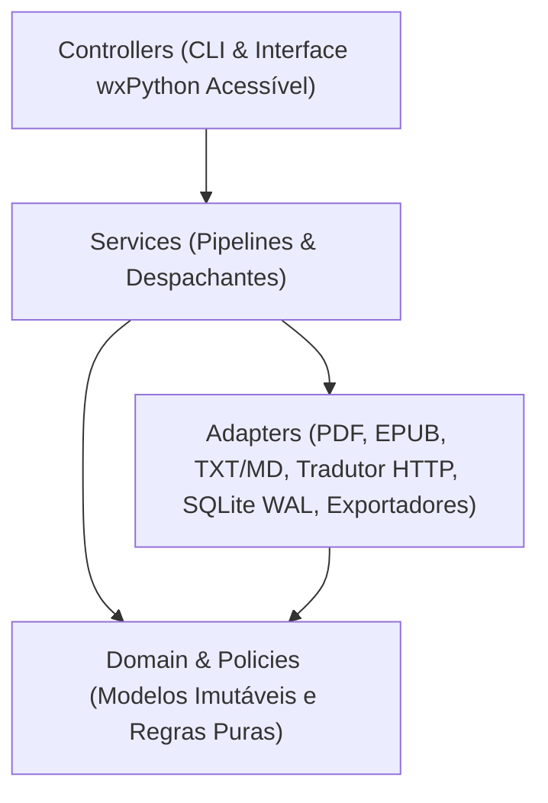

# Arquitetura do Sistema — Tradutor e Aprimorador Acessível de Livros

## 1. Visão Geral e Fluxo de Dependências

### Descrição Textual da Arquitetura (Acessível para Leitor de Tela / NVDA)
1. **Camada de Entrada (`controllers`):** Recebe comandos por linha de comando ou pela interface gráfica `wxPython` acessível (incluindo menu `&Ajuda` com Manual HTML5 em `F1`, verificação `F5` e diálogo Sobre) e delega diretamente para os serviços de processamento sem conter regras de negócio.
2. **Camada de Aplicação (`services`):** Coordena a extração, a tradução em lotes com cache SQLite WAL, a exportação atômica no formato escolhido e a orquestração segura do atualizador interno.
3. **Núcleo de Domínio e Políticas (`domain` e `policies`):** Estruturas imutáveis/modelos do livro, versão canônica do aplicativo e funções puras determinísticas para normalização tipográfica, fatiamento por sentenças, validação de caminhos, localização de rótulos, descoberta de capítulos e comparação SemVer / validação de manifesto sem I/O.
4. **Camada de Adaptadores (`adapters`):** Implementa toda a integração externa real com `pymupdf` (PDF), `HTMLParser`/`zipfile` (EPUB), arquivos TXT/MD, cliente HTTP isolado do Google Translate, cliente HTTP de Release Assets do GitHub (`latest.json` e `.zip` com `SHA-256`), instalador trampolim `.cmd` no Windows, banco SQLite WAL e escrita atômica nos cinco formatos de saída.

## 2. Onde vive (Mapa Canônico de Módulos)

| Subsistema / Preocupação | Caminho no Repositório | Papel (`Role`) | Invariante Principal |
| :--- | :--- | :--- | :--- |
| Entrada CLI e dispatch GUI | `book_translator.py` | `controller` | Protege `stdout`/`stderr` em executável `--windowed` |
| Fachada de extração | `extractor.py` | `service` | Mantém API pública compatível de extração |
| Fachada de tradução | `translator.py` | `service` | Mantém API pública compatível de tradução |
| Fachada de exportação | `epub_builder.py` | `service` | Mantém API pública compatível de exportação |
| Pacote raiz `src` | `src/__init__.py` | `value` | Marcador de pacote Python |
| Pacote `domain` | `src/domain/__init__.py` | `value` | Marcador do domínio |
| Modelos e exceções | `src/domain/models.py` | `value` | Preserva `original_title` e `detected_source_lang` |
| Versão e URLs de release | `src/domain/version.py` | `value` | Fonte única de `APP_VERSION` e endereço `latest.json` |
| Modelos de atualização | `src/domain/update_models.py` | `value` | Estruturas imutáveis e exceções do atualizador |
| Pacote `policies` | `src/policies/__init__.py` | `policy` | Marcador de políticas puras |
| Idiomas e rótulos localizados | `src/policies/i18n_labels.py` | `policy` | Localiza rótulos estruturais pelo idioma alvo |
| Normalização e reflow | `src/policies/text_normalizer.py` | `policy` | Normaliza ligaturas, espaços e títulos sem I/O |
| Fatiador por sentenças | `src/policies/sentence_splitter.py` | `policy` | Garante chunks <= 3600 chars e <= 10500 bytes URL |
| Caminhos e validação de páginas | `src/policies/path_policy.py` | `policy` | Valida `start_page <= end_page` e gera `_parcial` |
| SemVer e segurança ZIP | `src/policies/semver_policy.py` | `policy` | Valida `latest.json`, SemVer e bloqueia Zip Slip |
| Heurísticas tipográficas PDF | `src/policies/pdf_heuristics.py` | `policy` | Detecta cabeçalhos, rodapés, notas e subtítulos |
| Metadados de capa PDF | `src/policies/pdf_metadata_policy.py` | `policy` | Infere título, autor e fonte predominante |
| Camadas explícitas/numeradas PDF | `src/policies/pdf_chapter_layers_explicit.py` | `policy` | Descobre marcadores explícitos e listas numeradas |
| Descoberta de capítulos PDF | `src/policies/pdf_chapter_discovery.py` | `policy` | Preserva capítulos na pág. 2 com corpo textual |
| Conteúdo do manual HTML5 | `src/policies/user_manual_content.py` | `policy` | Gera HTML5 acessível do manual sem I/O |
| Pacote `adapters` | `src/adapters/__init__.py` | `adapter` | Marcador de adaptadores |
| Unidades lógicas de página PDF | `src/adapters/pdf_page_units.py` | `adapter` | Separa blocos em unidades lógicas e drop-caps |
| Extrator principal de PDF | `src/adapters/pdf_extractor.py` | `adapter` | Suporta múltiplos capítulos na mesma página do TOC |
| Parser estrutural EPUB | `src/adapters/epub_parser.py` | `adapter` | Usa `HTMLParser`, `unquote` e `unescape` |
| Extrator TXT e Markdown | `src/adapters/text_md_parser.py` | `adapter` | Preserva `#` internos e filtra intervalo de seções |
| Cache SQLite WAL | `src/adapters/sqlite_cache.py` | `adapter` | Opera em modo WAL com timeout seguro |
| Cliente HTTP Google Translate | `src/adapters/google_translate_client.py` | `adapter` | Mantém fallback SSL restrito ao opener local |
| Cliente GitHub Release Assets | `src/adapters/github_release_client.py` | `adapter` | Baixa `latest.json` e `.zip` validando `SHA-256` |
| Instalador trampolim Windows | `src/adapters/windows_swap_installer.py` | `adapter` | Extrai seguro em staging e troca via `.cmd` pós-PID |
| Gravador atômico de saída | `src/adapters/atomic_file_writer.py` | `adapter` | Gera erro acionável em `PermissionError` sem lixo |
| Exportador EPUB 3 | `src/adapters/epub_exporter.py` | `adapter` | Grava `lang` original real e rótulos localizados |
| Exportador HTML5 | `src/adapters/html_exporter.py` | `adapter` | HTML acessível com landmarks e `lang` original real |
| Exportadores Markdown e TXT | `src/adapters/md_txt_exporter.py` | `adapter` | Sumário com âncoras e rótulos localizados |
| Fontes Unicode e layout PDF | `src/adapters/pdf_fonts_layout.py` | `adapter` | Quebra URLs longas e seleciona fonte Unicode real |
| Exportador PDF A4 | `src/adapters/pdf_exporter.py` | `adapter` | Escapa `/Names`, `/Outlines` e salva atomicamente |
| Pacote `services` | `src/services/__init__.py` | `service` | Marcador de serviços |
| Tradutor em lote | `src/services/batch_translator.py` | `service` | Alinhamento 1:1 com captura de idioma detectado |
| Despachante de I/O de livros | `src/services/book_io_dispatch.py` | `service` | Roteia extração e exportação por extensão/formato |
| Pipeline principal de livros | `src/services/book_pipeline.py` | `service` | Exporta só ao final ou gera `_parcial` ao pausar |
| Serviço de auto-atualização | `src/services/self_update_service.py` | `service` | Orquestra checagem, staging e proteção em código-fonte |
| Serviço do manual de ajuda | `src/services/help_manual_service.py` | `service` | Grava manual atômico e abre no navegador |
| Pacote `controllers` | `src/controllers/__init__.py` | `controller` | Marcador de controladores |
| Construtor de controles GUI | `src/controllers/gui_controls_builder.py` | `controller` | Mnemônicos `Alt` exclusivos e idioma na Aba 2 |
| Diálogos e preview da aba GUI | `src/controllers/gui_tab_dialogs.py` | `controller` | Diálogos de arquivo e renderização de sumário |
| Aba de fluxo de trabalho GUI | `src/controllers/gui_workflow_tab.py` | `controller` | Preview assíncrono em thread e espera cooperativa |
| Diálogos e menu de atualização | `src/controllers/gui_update_dialog.py` | `controller` | Menu Ajuda acessível (`F1` / `F5`) e progresso de download |
| Janela principal GUI | `src/controllers/gui_frame.py` | `controller` | Atalho `Esc` ocioso e encerramento seguro de threads |
| Instrumento de voo único | `tools/dev.py` | `controller` | Gate único `doctor`, linters, `build --if-stale` e testes |
| Regras estáticas de governança | `tools/arch_checks.py` | `policy` | Valida `# Role:`, teto `<= 250` linhas e tabela viva |
| Empacotador de release assets | `tools/build_release_assets.py` | `controller` | Valida paridade de tag e gera `.zip` + `latest.json` |
